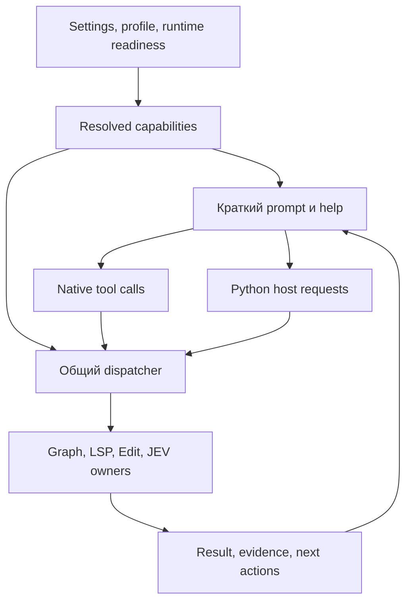

# Allspark fork.012: прогресс, интеграционные разрывы и удобство инструментов для агентов

Дата проверки: **27 октября 2026**. Проверенная версия: **`allspark-v0.10.2-beta.10-fork.012`**, commit **`70dbe0a681b2b7fdb0145a17f51d3228f187a82f`**. База предыдущего аудита: **`4f1e7a63cd0d28cdd0d16e627b4132a932575cf2`**. Между ними — **60 коммитов, 155 изменённых файлов, +9 260 / −1 258 строк**. Все ссылки на код ниже закреплены за проверенным commit; последующие исправления в main в этот вывод не входят. [Сравнение версий](https://github.com/rager306/allspark/compare/4f1e7a63cd0d28cdd0d16e627b4132a932575cf2...70dbe0a681b2b7fdb0145a17f51d3228f187a82f).

## 1. Главная оценка

**Прогресс существенный: fork.012 исправляет реальные потери фактов и нарушения связности контекста.** ToolResult доходит до summarizer; поздние receipts повторно накладываются при перестроении контекста; graph проверяет сохранённые связи receipt chain и хеширует именно разобранные байты; LSP запускает независимые серверы без прежней общей сериализации. Появились рабочие consumers для graph watch и LSP idle timeout.

**Следующий предел развития — согласованность уже написанных компонентов.** В нескольких местах исправлена функция или один consumer, но не вся цепочка: helper памяти не получает путь от настоящего worker; discovery вновь стирается последующим rebuild; GraphTool и watcher вычисляют разные project keys; ADR list учитывает scope, get-by-id — нет. Такой класс дефектов требует проверок через реальные точки сборки session/catalog/workspace, а не увеличения числа изолированных unit tests.

**Выпуск пока не завершён.** Tag запушен, но release workflow завершился failure, публикация была пропущена; GitHub Release по tag на момент проверки отсутствовал. CI тоже содержит два отдельных packaging/test-contract отказа. Это важно и для диагностики инструментов: наличие кода в tag ещё не устанавливает, что работающий у пользователя daemon уже выполняет этот build.

**Замечание об удобстве для агентов подтверждается, но причина точнее, чем полное отсутствие инжекции.** Стандартный engine действительно добавляет native-tools в prompt и передаёт схемы инструментов модели. Проблемы — расхождение diagnostic dump с реальным builder, конкурирующие инструкции, неполные descriptions/примеры, зависимость бесплатных подсказок от выключенного JEV и отсутствие единого resolved описания возможностей. Подробный план исправления приведён в разделе 5.

## 2. Что реально закрыто, а что только частично

| Область | Изменение fork.012 | Оценка |
|---|---|---|
| ToolResult → compaction / branch summary | Сохраняются все Message, включая tool results | Исправлено в рабочих преобразователях |
| Late receipts после rebuild | Общий `rebuild_loop_context`, production callers, интеграционный тест AgentSession | Исправлено в рассмотренных путях |
| Старые Python namespace notices | В активном контексте остаётся новейший `ipython_state`, история сохраняется | Полезная оптимизация бюджета контекста |
| Refinement expectation / outcome | Новые события разделяют ожидаемый и наблюдаемый результат | Исправлено для новых событий; legacy требует миграции |
| Worker-local harness | Добавлен fallback через `SessionManager.session_file` | Частично: worker этот путь не устанавливает |
| Профиль no-memories | Python получает API exclusions | Частично: Rust policy и Python proxy остаются несогласованными |
| Corrupt harness JSON | Python пытается сохранить quarantine | Частично: Rust writer не защищён, Python подавляет отказ quarantine |
| Graph warm root / basename collisions | GraphTool проверяет root и добавляет suffix к конфликтующему key | Исправлен tool-path; startup/watch используют старый key |
| Parse/hash TOCTOU | Hash переносится вместе с parsed bytes | Исправлен конкретный дефект snapshot provenance |
| Receipt chain | Проверяются сохранённые prev_hash | Исправлено, добавлен адресный regression test |
| ADR | Scoped list, чтение body, миграция legacy | Частично: get-by-id и supersedes не проверяют scope |
| Watch / freshness | Watch подключён, warm query проверяет известные hashes | Частично: additions и dropped busy batch остаются дырой |
| LSP | Per-key single-flight, consumer idle timeout | Реальное архитектурное улучшение; idle eviction ленивый |
| Child completion | Ошибка наблюдения больше не означает автоматический done | Старый случай закрыт, остаётся узкий failed-without-message edge |
| Persistent bash | Непрочитанный результат переживает completion | Исправлено; durable host ACK ещё не введён |
| Factory / terminal notices | Нового durable state/outbox нет | Открытый прежний долг |
| Test governance | RowFileMissing включён, добавлена проверка registry/schedule | Улучшено; reachability и отдельные assertions требуют ремонта |
| Miri / ASan / Shuttle | Появился вызывающий verify workflow | Wiring исправлен; это не доказательство успешного исполнения всех lanes |

Опорные источники: [compaction](https://github.com/rager306/allspark/blob/70dbe0a681b2b7fdb0145a17f51d3228f187a82f/crates/pa-core/src/session_engine/compact_session.rs#L64-L88), [context projection](https://github.com/rager306/allspark/blob/70dbe0a681b2b7fdb0145a17f51d3228f187a82f/crates/pa-core/src/session_engine/mod.rs#L565-L608), [namespace projection](https://github.com/rager306/allspark/blob/70dbe0a681b2b7fdb0145a17f51d3228f187a82f/crates/pa-core/src/session/mod.rs#L373-L385), [incremental hash](https://github.com/rager306/allspark/blob/70dbe0a681b2b7fdb0145a17f51d3228f187a82f/crates/pa-graph/src/incremental.rs#L359-L392), [receipt verification](https://github.com/rager306/allspark/blob/70dbe0a681b2b7fdb0145a17f51d3228f187a82f/crates/pa-graph/src/store.rs#L535-L571), [LSP single-flight](https://github.com/rager306/allspark/blob/70dbe0a681b2b7fdb0145a17f51d3228f187a82f/crates/pa-lsp/src/manager.rs#L367-L431), [verify caller](https://github.com/rager306/allspark/blob/70dbe0a681b2b7fdb0145a17f51d3228f187a82f/.github/workflows/verify.yml).

## 3. Блокеры выпуска и CI

### 3.1. Release smoke использует старый путь архива

В [release run 40464240124](https://github.com/rager306/allspark/actions/runs/40464240124) сборка dist, загрузка/проверка bundled catalog и упаковка прошли. Упал шаг **Prove the packaged launcher runs**. Сообщение в job log:

```text
tar (child): prime-agent-0.10.2-beta.10-fork.012-linux-x64.tar.gz:
Cannot open: No such file or directory
```

Producer уже пишет `dist/${root}.tar.gz`, а smoke по-прежнему извлекает `${root}.tar.gz` из корня. Это доказанный workflow defect, не предположение по названию test. Upload `path: dist/`, новый complete-set guard и checksum guard полезны; старую претензию к отсутствию channel assets в upload переносить сюда неправильно. [Producer и smoke](https://github.com/rager306/allspark/blob/70dbe0a681b2b7fdb0145a17f51d3228f187a82f/.github/workflows/release-fork.yml#L184-L254).

**Исправление:** smoke должен читать фактический staging path. Затем один явно заданный artifact contract должен связывать упаковку, smoke, checksums и upload. Проверять получившийся staged набор, а не четыре независимые копии строк путей. Уже опубликованный tag не следует молча переназначать: исправление оформлять следующей версией по принятой политике проекта.

### 3.2. В CI два самостоятельных отказа

[CI run 40464206595](https://github.com/rager306/allspark/actions/runs/40464206595) завершился failure. Fullcheck/clippy, formatting, deny, Windows crosscheck и historical-upgrade packaging прошли; шесть из восьми Rust test shards прошли. `continuous`, `nightly` и Push on main также успешны для данного SHA. Это заметный прогресс относительно предыдущего среза, но не полностью зелёный release gate.

| Отказ | Наблюдение | Правильная правка |
|---|---|---|
| Shard 1, launcher extraction | `sh: 47: fork_layout: parameter not set` | Дополнить контракт `check_socket_pin.install_launcher`, который извлекает часть installer и не задаёт новую переменную |
| Shard 4, installer_stop_gate | Тест ищет старые отдельные строки `stable`/`latest.json` в upload | Обновить устаревший oracle под передачу каталога `dist/`, проверяя смысл artifact set |

[Extraction helper](https://github.com/rager306/allspark/blob/70dbe0a681b2b7fdb0145a17f51d3228f187a82f/scripts/check_socket_pin.py#L48-L69), [stale literal oracle](https://github.com/rager306/allspark/blob/70dbe0a681b2b7fdb0145a17f51d3228f187a82f/crates/pa-cli/tests/installer_stop_gate.rs#L698-L724). Installer, launcher и update scripts локально при аудите не исполнялись; вывод подтверждён уже произошедшими CI failures и чтением источников.

## 4. Главные архитектурные разрывы

### 4.1. Discovery теряется при следующем rebuild, даже после нового исправления порядка

Schema v2, provider identity, накопление deprecations, auth headers и восстановление saved snapshot исправлены. Однако discovery остаётся мутацией `self.models` после одного из rebuild, а не полноценным входом сборки каталога.

В `refresh_available_models_forced` после `refresh_discovery` вызывается `refresh_private_prime_inference_authorization`. При отсутствии Prime key этот путь делает `clear_private_authorization()`, который снова вызывает `load_models()`. Последний присваивает `self.models` из curated/custom/private inputs без discovery overlay. То есть даже обычный пользователь без Prime auth может потерять только что обнаруженные ID. Non-forced picker refresh тоже перестраивает массив без повторного применения saved discovery. `get_available` лишь фильтрует текущий массив и ничего не восстанавливает. [Refresh](https://github.com/rager306/allspark/blob/70dbe0a681b2b7fdb0145a17f51d3228f187a82f/crates/pa-core/src/models/registry.rs#L1052-L1125), [load_models](https://github.com/rager306/allspark/blob/70dbe0a681b2b7fdb0145a17f51d3228f187a82f/crates/pa-core/src/models/registry.rs#L458-L488), [clear](https://github.com/rager306/allspark/blob/70dbe0a681b2b7fdb0145a17f51d3228f187a82f/crates/pa-core/src/models/registry.rs#L1240-L1244).

Есть вторая граница: неизвестный ID создаётся с `api="openai-completions"` и пустым `base_url`. OpenAI completions transport собирает URL прямо из этого поля. Существование ID не делает его готовым к запросу: без последующего корректного provider transport/override это относительный `/chat/completions`. Нельзя объявлять все discovered providers совместимыми с одной dialect. [Model construction](https://github.com/rager306/allspark/blob/70dbe0a681b2b7fdb0145a17f51d3228f187a82f/crates/pa-core/src/models/registry.rs#L899-L935), [request URL](https://github.com/rager306/allspark/blob/70dbe0a681b2b7fdb0145a17f51d3228f187a82f/crates/pa-ai/src/providers/openai_completions/stream.rs#L612-L634).

**Рекомендация:** одна функция сборки effective catalog из versioned inputs: curated models, custom config, discovery, auth, provider capabilities. Любое изменение inputs заканчивается этой же сборкой. Разделить `DiscoveredModel` и request-ready `RunnableModel`; неизвестные limits/cost маркировать как estimated/unknown. Acceptance: restart → picker open → auth refresh → forced discovery → request construction сохраняют ID и валидный transport. Новый constructor-only offline test не покрывает эту последовательность.

### 4.2. Local harness: поправлен helper, но настоящий worker не передаёт предпосылку

Новый `local_harness_state_dir` умеет вычислить путь из `SessionManager.get_session_file()`. Но daemon создаёт non-persisted manager и копирует в него durable header ID через `new_session`; самого session_file у manager не появляется. Kernel/digest используют отдельный `config.conversation_log_path`, поэтому пути writer и reader всё ещё могут разойтись. Новый regression test вручную вызывает `manager.set_session_file`, чего нет в рассмотренном production worker path. [Helper](https://github.com/rager306/allspark/blob/70dbe0a681b2b7fdb0145a17f51d3228f187a82f/crates/pa-core/src/session_engine/refine.rs#L246-L256), [worker](https://github.com/rager306/allspark/blob/70dbe0a681b2b7fdb0145a17f51d3228f187a82f/crates/pa-daemon/src/agent_engine/lifecycle.rs#L1084-L1118), [reader path](https://github.com/rager306/allspark/blob/70dbe0a681b2b7fdb0145a17f51d3228f187a82f/crates/pa-core/src/session_engine/engine.rs#L456-L470), [fixture](https://github.com/rager306/allspark/blob/70dbe0a681b2b7fdb0145a17f51d3228f187a82f/crates/pa-core/src/session_engine/refine.rs#L1345-L1372).

**Рекомендация:** вычислять `SessionMemoryContext` в worker composition root и передавать один объект kernel, digest, refine и recall: session id, workspace id, conversation log, artifact dir, local/global memory policy. Не включать persistence у внутреннего manager ради побочного исправления пути: durable journal уже принадлежит worker. Gate должен создавать worker настоящим production builder, записывать local refinement и читать его из следующего digest.

### 4.3. Memory policy и сохранность данных пока зависят от языка writer

Новые Python API exclusions работают для прямого getter и записи. Rust `refinement_gate` всё ещё проверяет только master setting, поэтому `no-memories` не гарантирует отсутствия Rust digest/refine. Это особенно мешает чистоте benchmark. Дополнительная реальная Python-проба показала: прямой getter сообщает `API excluded`, а `rlm.harness.list("memory")` возвращает `[]`, потому что proxy проглатывает RuntimeError и создаёт пустой fallback. Агент не различает запрет и пустую память. [Rust gate](https://github.com/rager306/allspark/blob/70dbe0a681b2b7fdb0145a17f51d3228f187a82f/crates/pa-core/src/session_engine/refinement_gate.rs#L5-L12), [proxy](https://github.com/rager306/allspark/blob/70dbe0a681b2b7fdb0145a17f51d3228f187a82f/prime-agent-runtime/src/rlm/__init__.py#L535-L557).

Python quarantine сохраняет corrupt JSON при обычной успешной записи backup. Но при искусственном `PermissionError` backup mutation всё равно завершилась успешно и перезаписала исходные bytes: исключение подавляется. Rust writer продолжает parse-error → empty → update → save без quarantine. Это доказанные границы реализации; они не означают, что у пользователя уже потерялись данные. [Python writer](https://github.com/rager306/allspark/blob/70dbe0a681b2b7fdb0145a17f51d3228f187a82f/prime-agent-runtime/src/rlm/harness.py#L690-L718), [Rust writer](https://github.com/rager306/allspark/blob/70dbe0a681b2b7fdb0145a17f51d3228f187a82f/crates/pa-core/src/refinement/mod.rs#L325-L341).

**Рекомендация:** общий policy contract для read/write/refine/inject, явные состояния `Empty`, `Disabled(reason)`, `Corrupt(path,error)` и одинаковая семантика записи. При невозможности сохранить corrupt payload запись должна останавливаться или оставлять исходник неприкосновенным. Legacy `outcome`, где раньше хранился прогноз, следует помечать `legacy_unverified`, а не автоматически рендерить как observed. [Outcome renderer](https://github.com/rager306/allspark/blob/70dbe0a681b2b7fdb0145a17f51d3228f187a82f/crates/pa-core/src/refinement/ranking.rs#L349-L376).

Отдельно остаётся прежняя ошибка LCA branch summary: leaf→root путь разворачивается перед поиском общего узла, что выбирает root-most общий узел вместо ближайшего. В дереве `r→a→b→{old,target}` это `r` вместо `b`. Это адресный алгоритмический fix с проверкой входа summarizer, не повод менять весь storage. [LCA](https://github.com/rager306/allspark/blob/70dbe0a681b2b7fdb0145a17f51d3228f187a82f/crates/pa-core/src/session_engine/branch_summarization.rs#L51-L80).

### 4.4. Workspace identity исправлена только в GraphTool

Explicit GraphTool теперь разрешает одноимённые roots через `basename#digest` и проверяет warm root. Прежнее молчаливое чтение чужого индекса в этом пути исправлено. Однако startup indexing и watcher продолжают вычислять basename. Второй `/b/service` работает через явный tool, но auto/watch пытаются обновить `service` первого `/a/service` и получают root mismatch. ADR до первой регистрации root также может получить plain basename, а затем оказаться под старым key. [Resolver](https://github.com/rager306/allspark/blob/70dbe0a681b2b7fdb0145a17f51d3228f187a82f/crates/pa-core/src/tools/graph.rs#L44-L91), [automatic callers](https://github.com/rager306/allspark/blob/70dbe0a681b2b7fdb0145a17f51d3228f187a82f/crates/pa-core/src/session_engine/engine.rs#L665-L714), [watch](https://github.com/rager306/allspark/blob/70dbe0a681b2b7fdb0145a17f51d3228f187a82f/crates/pa-core/src/session_engine/graph_watch.rs#L170-L211).

Default ADR list scoped, body доступен — это полезная законченная часть. Но id branch вызывает глобальный `get_adr(id)` без проверки project; `supersedes` также не проверяет scope цели. Это нарушение семантики workspace memory, не заявляемая security boundary. [ADR adapter](https://github.com/rager306/allspark/blob/70dbe0a681b2b7fdb0145a17f51d3228f187a82f/crates/pa-core/src/tools/graph.rs#L1703-L1808).

**Рекомендация:** общий `WorkspaceIdentity` для tools, startup, watch, ADR и будущего recall; resolve/register до любых writes. Default scoped get/supersedes должны требовать тот же workspace; `scope=all` остаётся явным расширением. Gate: два same-basename checkout, ADR до index, explicit search, auto/watch, reopen. Новый collision test надо исправить: он читает `details["hits"]` как массив, хотя массив называется `results`; negative assertion сейчас вакуумный. [Oracle](https://github.com/rager306/allspark/blob/70dbe0a681b2b7fdb0145a17f51d3228f187a82f/crates/pa-core/src/tools/graph.rs#L4065-L4077).

### 4.5. Freshness: add-only и busy writer всё ещё могут оставить незаметно старый graph

`root_is_stale` проверяет hashes уже известных файлов. Новый source file, когда существующие не изменились, не делает эту проверку stale. Watch обычно замечает creation, но при занятой writer lease batch отбрасывается; fallback query такой add-only случай не восстанавливает. Implicit refresh также не сохраняет прежний IndexScope. [Stale check](https://github.com/rager306/allspark/blob/70dbe0a681b2b7fdb0145a17f51d3228f187a82f/crates/pa-core/src/tools/graph.rs#L465-L497), [busy batch](https://github.com/rager306/allspark/blob/70dbe0a681b2b7fdb0145a17f51d3228f187a82f/crates/pa-core/src/session_engine/graph_watch.rs#L165-L199).

При успешном JEV rerank `result.content` заменяется новым текстом, теряя status/cascade и новые stale/refresh предупреждения. Это особенно нежелательно для агента: качество ранжирования не должно скрывать актуальность источника. [Replacement](https://github.com/rager306/allspark/blob/70dbe0a681b2b7fdb0145a17f51d3228f187a82f/crates/pa-core/src/tools/graph.rs#L1354-L1366).

**Рекомендация:** dirty generation/pending set переживает занятость lease; reconciliation обнаруживает additions/removals и изменения discovery policy; query возвращает bounded freshness result. Единый envelope `{workspace, snapshot, indexed_revision, stale_reason, data}` проходит через ranking без потери metadata. Gate: add-only при busy writer → quiescence → новый символ доступен либо ответ явно stale/unknown. Не нужен новый движок БД, чтобы выразить эту гарантию.

### 4.6. Runtime: восстановление улучшено, durable workflow ещё предстоит

Unread persistent-shell output теперь сохраняется после completion — старый дефект исправлен. Но local read acknowledgement ещё не означает durable receipt родителя: crash между чтением Python cell и сохранением host result оставляет окно потери. Новый `discard()` удаляет файлы и для незавершённого synthetic handle; это подтверждено реальным методом без запуска процесса. Штатных production callers в таком состоянии не найдено, поэтому это условный API lifecycle риск, а не доказанная массовая утечка процессов. [Retention](https://github.com/rager306/allspark/blob/70dbe0a681b2b7fdb0145a17f51d3228f187a82f/prime-agent-runtime/src/rlm/bash.py#L1308-L1317), [discard](https://github.com/rager306/allspark/blob/70dbe0a681b2b7fdb0145a17f51d3228f187a82f/prime-agent-runtime/src/rlm/bash.py#L1259-L1281).

Ошибка answer observation больше не превращается автоматически в done. Остался узкий edge: два одинаковых RPC, отброшенный `child_failed`, и `failed=true,error=null` при недоступном fallback-файле ещё могут стать done. Обычный сохранённый error-row новый fallback обрабатывает. [Settlement](https://github.com/rager306/allspark/blob/70dbe0a681b2b7fdb0145a17f51d3228f187a82f/crates/pa-daemon/src/rlm_children/lifecycle.rs#L488-L562).

Factory остаётся RAM-only, terminal notice помечается delivered до отправки, а cancel timeout не отличён от подтверждённого отказа. [Factory](https://github.com/rager306/allspark/blob/70dbe0a681b2b7fdb0145a17f51d3228f187a82f/prime-agent-runtime/src/rlm/factory.py#L1540-L1572), [notice](https://github.com/rager306/allspark/blob/70dbe0a681b2b7fdb0145a17f51d3228f187a82f/crates/pa-daemon/src/rlm_children/lifecycle.rs#L808-L835).

Следующий срез здесь: один typed observation с text/status/source/diagnostic; operation IDs; durable completion receipt; outbox для уведомлений с повторной доставкой и dedup. Для Factory — supervisor-owned run/action/attempt state и reconciliation выживших children после restart. Произвольные shell side effects нельзя автоматически повторять только потому, что потерялся ответ.

## 5. Документирование и удобство для агентов

### 5.1. Инжекция существует; диагностика и инструкции с ней расходятся

Рабочая цепочка уже есть: settings → создание tools → profile filtering → sorted effective roster → native-tools segment → provider definitions. `pa-agent` отправляет провайдеру настоящие name/description/parameters. Custom SYSTEM заменяет статический prefix, но сам по себе не удаляет dynamic native section. Поэтому по этому tag нельзя заключить, что agent вообще не получает информации. При этом prompt конкретной установленной пользовательской сессии в этом аудите не захватывался. [Engine](https://github.com/rager306/allspark/blob/70dbe0a681b2b7fdb0145a17f51d3228f187a82f/crates/pa-core/src/session_engine/engine.rs#L878-L909), [injection](https://github.com/rager306/allspark/blob/70dbe0a681b2b7fdb0145a17f51d3228f187a82f/crates/pa-core/src/prompts/system_prompt.rs#L202-L211), [provider wire](https://github.com/rager306/allspark/blob/70dbe0a681b2b7fdb0145a17f51d3228f187a82f/crates/pa-agent/src/agent_loop/response.rs#L129-L138).

**`allspark prompt --json` сейчас не является достоверным effective-session dump.** Он жёстко передаёт `selected_tools=[python_repl]`, не разрешает tool profile и пропускает append/profile guidance. Его результат способен создать именно впечатление отсутствующей инжекции. Настоящий `get_system_prompt` существующей сессии уже возвращает `engine.system_prompt()`: следует строить диагностику на этом пути, а offline dump явно обозначать как симуляцию с известными inputs. [CLI](https://github.com/rager306/allspark/blob/70dbe0a681b2b7fdb0145a17f51d3228f187a82f/crates/pa-cli/src/prompt_command.rs#L79-L129), [live getter](https://github.com/rager306/allspark/blob/70dbe0a681b2b7fdb0145a17f51d3228f187a82f/crates/pa-daemon/src/state_getters.rs#L234-L246).

`readme-fork.md` и `FORK.md` автоматически не становятся product-session instructions. Resource discovery загружает соответствующие AGENTS/CLAUDE файлы из разрешённых мест; skill inventory показывает metadata/import/location, а не полное содержимое всех skills. Публикация подробного README полезна человеку, но доступность его текста агенту требует отдельного runtime пути. [Resource discovery](https://github.com/rager306/allspark/blob/70dbe0a681b2b7fdb0145a17f51d3228f187a82f/crates/pa-core/src/resources/mod.rs#L15-L95), [skill inventory](https://github.com/rager306/allspark/blob/70dbe0a681b2b7fdb0145a17f51d3228f187a82f/crates/pa-core/src/skills/mod.rs#L224-L282).

### 5.2. Конкретные ошибки agent-facing контракта

**1. Два разных edit объявлены основными.** Статический core называет `edit.run` в Python главным способом правок; usage даёт `await edit(...)`. Dynamic section требует top-level `edit` для каждой модификации и подчёркивает, что native tools не вызываются через REPL. Python edit skill при этом действительно отдельная реализация. Нужно явно объяснить: **HybridEdit — product name, `edit` — native wire name; Python `edit.run` — другой путь**. Выбранный default и fallback должны генерироваться из active capabilities. [Core](https://github.com/rager306/allspark/blob/70dbe0a681b2b7fdb0145a17f51d3228f187a82f/crates/pa-core/src/prompts/layers/core.md#L27-L29), [native policy](https://github.com/rager306/allspark/blob/70dbe0a681b2b7fdb0145a17f51d3228f187a82f/crates/pa-core/src/prompts/system_prompt.rs#L360-L376), [Python skill](https://github.com/rager306/allspark/blob/70dbe0a681b2b7fdb0145a17f51d3228f187a82f/skills/edit/SKILL.md#L37).

**2. Hashline help требует предварительную операцию, которая не подключена.** Текст реально инжектируется, но требует `[PATH#TAG]` из `read/search`, предлагает `write` для новых файлов и fresh read после правок. SessionEngine создаёт EditStore и передаёт его только EditHybridTool; встроенного reader, выдающего tags и отмечающего показанные строки в этом же store, не найдено. Обычные Python/bash/LSP reads такой регистрации не делают. Hashline engine способен работать с корректным tag; незавершён именно обещанный агенту путь. Тест получает tag через прямой `file_hash`, минуя доступные агенту операции. [Injected hashline text](https://github.com/rager306/allspark/blob/70dbe0a681b2b7fdb0145a17f51d3228f187a82f/crates/pa-edit/prompts/hashline.md#L1-L30), [ownership](https://github.com/rager306/allspark/blob/70dbe0a681b2b7fdb0145a17f51d3228f187a82f/crates/pa-core/src/session_engine/engine.rs#L739-L777), [fixture](https://github.com/rager306/allspark/blob/70dbe0a681b2b7fdb0145a17f51d3228f187a82f/crates/pa-core/src/tools/edit_hybrid.rs#L540-L555).

При отсутствии snapshot/seen set hashline guard возвращает success. `replace` stage игнорирует `_store` и сам читает файл; требование prior read здесь остаётся инструкцией модели. Нельзя документировать эти guards как гарантированно пройденный read-history контроль в сегодняшнем product workflow. Кроме того, prompt всегда говорит default replace и инжектирует hashline, даже когда allowModes исключает hashline или default настроен иначе. [Seen guard](https://github.com/rager306/allspark/blob/70dbe0a681b2b7fdb0145a17f51d3228f187a82f/crates/pa-edit/src/modes/hashline/patcher.rs#L358-L377), [replace stage](https://github.com/rager306/allspark/blob/70dbe0a681b2b7fdb0145a17f51d3228f187a82f/crates/pa-edit/src/modes/replace.rs#L182-L212).

**3. Graph helper неверно обучает impact analysis.** Skill/core/router связывают blast radius изменения X с `out`. В реальном call graph edge идёт caller → callee: `out` показывает зависимости X, `in` — вызывающих X. Для последствий изменения публичного API нужно начинать с incoming consumers, затем учитывать другие edge types и ограничения coverage. Сам обход не доказывает весь semantic impact. [Routing table](https://github.com/rager306/allspark/blob/70dbe0a681b2b7fdb0145a17f51d3228f187a82f/skills/graph/SKILL.md#L28-L36), [actual traversal](https://github.com/rager306/allspark/blob/70dbe0a681b2b7fdb0145a17f51d3228f187a82f/crates/pa-graph/src/trace.rs#L364-L384).

Реальная pure-Python проба также дала `symbol="chain"` для `chain from A to B`; обещанное `what breaks if I change Payment` ушло в search; `loadConfig` превратился в `loadconfig`. `format_call` удаляет `why` из исходного dict и добавляет `//` в возвращаемый текст, поэтому целая строка не является JSON payload. Предлагаемый ответ helper: `{tool, arguments, explanation}`, без мутации входа, с сохранением регистра и schema-valid arguments. Для очевидного запроса дополнительный вызов router не нужен. [Helper](https://github.com/rager306/allspark/blob/70dbe0a681b2b7fdb0145a17f51d3228f187a82f/skills/graph/src/graph/__init__.py#L15-L122).

**4. Contextual advisor выключен по умолчанию и иногда рекомендует несуществующую операцию.** ToolArbiter уже имеет дешёвую regex-часть и optional JEV strengthening. Однако `jev.enabled=off` отключает обе части. Для подсказок о native tools не требуется платное суждение модели. Правило `cat/head/tail/bat → edit` говорит, что edit читает файл с номерами строк; у native edit read-action отсутствует. Широкая замена любого rg/find на graph также не соответствует logs/config/literals вне index coverage. [Admission](https://github.com/rager306/allspark/blob/70dbe0a681b2b7fdb0145a17f51d3228f187a82f/crates/pa-core/src/jev/tool_arbiter.rs#L753-L758), [rules](https://github.com/rager306/allspark/blob/70dbe0a681b2b7fdb0145a17f51d3228f187a82f/crates/pa-core/src/jev/tool_arbiter.rs#L185-L225).

Разделить настройки deterministic guidance и optional JEV judge. Подсказку давать лишь при наличии подходящей операции и достаточной coverage; точные arguments и reason помогают больше, чем общее «используй graph». Повтор одного совета ограничивать на сессию/сценарий. Shell result, exit status и произведённое действие должны оставаться прозрачными.

**5. Некоторые инструкции сильнее фактической гарантии.** Даже без LSP в roster общий workflow советует `lsp symbols`; edit-only session получает совет `lsp replace_symbol_body`. Успешный rename/safe-delete назван полностью согласованным по declarations/references/overrides/imports, с рекомендацией не проверять распространение. Реальный rename применяет WorkspaceEdit сервера, что не равнозначно проверке проекта. В safe-delete есть дополнительная статическая граница: `Ok(None)` становится пустым references без warmth guard обычного references path. Холодный сервер локально не запускался — это source-level finding. [Prompt](https://github.com/rager306/allspark/blob/70dbe0a681b2b7fdb0145a17f51d3228f187a82f/crates/pa-core/src/prompts/system_prompt.rs#L424-L446), [rename](https://github.com/rager306/allspark/blob/70dbe0a681b2b7fdb0145a17f51d3228f187a82f/crates/pa-lsp/src/tool.rs#L674-L705), [safe-delete](https://github.com/rager306/allspark/blob/70dbe0a681b2b7fdb0145a17f51d3228f187a82f/crates/pa-lsp/src/tool.rs#L772-L823).

Лучший протокол различает `preview`, `applied`, `diagnostics_pending`, `verified`. Агент избегает бессмысленной повторной работы, но выполняет проверку, соответствующую изменению. Семантические tools предпочтительны при наличии поддержки; при unavailable/partial/stale допустим явный ограниченный fallback.

**6. Profiles фильтруют tool name, но не native actions.** Planning/query исключают edit и некоторые отдельные Serena-style имена, однако native `lsp` остаётся единым инструментом с mutating actions и apply=true. Это семантическое расхождение режима и фактической поверхности, не security sandbox claim. Разрешения операций должны одинаково применяться в schema, dispatch и help; preview-only разрешение стоит выразить отдельно. [Planning profile](https://github.com/rager306/allspark/blob/70dbe0a681b2b7fdb0145a17f51d3228f187a82f/crates/pa-core/src/tool_profile/profile.rs#L310-L355), [name filter](https://github.com/rager306/allspark/blob/70dbe0a681b2b7fdb0145a17f51d3228f187a82f/crates/pa-core/src/tool_profile/profile.rs#L492-L520).

**7. Progressive disclosure существует как заготовка библиотеки.** `FacadeRegistry`, `Disclosure`, `PromptTemplateVars`/render_template имеют собственные tests; production callers для интеграции в session/kernel не найдены. README перечисляет supporting machinery, но это ещё не работающий `s.info(...)`. Их разумно довести до небольшого реального help endpoint, используя final roster, вместо добавления параллельного каталога. [Facade scope](https://github.com/rager306/allspark/blob/70dbe0a681b2b7fdb0145a17f51d3228f187a82f/crates/pa-core/src/tool_profile/facades.rs#L1-L8), [Disclosure](https://github.com/rager306/allspark/blob/70dbe0a681b2b7fdb0145a17f51d3228f187a82f/crates/pa-core/src/tool_profile/disclosure.rs#L97-L125), [README](https://github.com/rager306/allspark/blob/70dbe0a681b2b7fdb0145a17f51d3228f187a82f/readme-fork.md#L97-L115).

### 5.3. Предлагаемая архитектура: единое описание реальных возможностей с постепенным раскрытием

Ниже — **проект следующей доработки**, не существующий API. Небольшой `ResolvedCapabilities` формируется после profile resolution и регистрации runtime owners. Для каждой операции он содержит:

| Поле | Для чего агенту и runtime |
|---|---|
| id / invocation surface / exact tool and action | Отличить native `graph` от Python router и `rlm.factory.graph` |
| availability + reason + source | Ready, indexing, missing server, disabled by profile, missing judge; агент понимает, что делать |
| effect and permitted modes | Read, preview, workspace write, model call; actual edit default/allowModes |
| requirements / scope / freshness | Workspace, readiness, prior-read receipt, coverage; отсутствие факта не смешивается с отсутствием доступа |
| schema + one valid example | Сократить ошибочные arguments и поисковые round trips |
| fallback / result contract / next actions | Честно обработать unsupported language, stale graph, unavailable judge |
| version / documentation origin | Сопоставить help с build и диагностировать расхождение |

Из этого одного объекта строятся четыре consumer: provider schemas/dispatch checks; короткий стартовый блок; подробный help по запросу; CLI/live diagnostic inspector. Документация релиза также использует этот каталог, но человеческое описание может быть подробнее. Статические инструкции стабильны; session readiness меняет небольшой dynamic segment. Частое переписывание всего system prompt ухудшило бы существующую cache-friendly организацию.



Стартовая карточка должна отвечать на «когда выбрать», а не повторять все параметры:

| Задача | Предпочтительный инструмент | Что проверить / fallback |
|---|---|---|
| Найти реализацию поведения и структуру проекта | `graph search/architecture` | Coverage и freshness; literals/logs допускают текстовый поиск |
| Найти точное определение, references, rename | `lsp` | Server capability/readiness; preview перед мутацией, подходящая проверка после |
| Оценить consumers изменения API | `graph trace` incoming + LSP references | `out` — зависимости; неполный index не доказывает отсутствия callers |
| Изменить известный фрагмент | Native `edit` в разрешённом режиме | Свежий read receipt; корректный default; diff/diagnostics |
| Выбрать из неоднозначных вариантов | `jev`, если разрешён и готов judge | Факты и state передаются явно; uncertainty/escape допустимы |
| Скомпоновать поиск и обработать данные | Python RLM | Native facades используют тот же dispatcher; ниже описана ещё необходимая интеграция |

Ориентир — несколько сотен токенов стартовой карточки, затем action-specific examples по запросу. Это проектный budget, а не замер текущего prompt. Существующие статические слои уже содержат 24 817 UTF-8 bytes / 3 729 whitespace words до dynamic context; эти счётчики не являются provider token counts. Увеличение объёма само по себе не показывает рост adoption.

### 5.4. Полный read → edit → diagnostics workflow

Сделать bounded reader, который возвращает canonical path, numbered visible lines, snapshot tag и receipt, и разделяет один session-owned EditStore с editor. Отмечать именно показанные строки. После edit возвращать changed files, diff, новый tag, диагностику или её pending state. Для нового файла help должен показывать реально доступный create path. При external change/resume агент получает понятный stale/missing read result и точный повторный read.

Acceptance test должен пройти этот цикл исключительно через доступные агенту interfaces, без ручного вычисления file_hash и прямой вставки snapshot в fixture. Это одновременно улучшение удобства, защиты от случайной правки неувиденного текста и доказательности тестов.

### 5.5. Связь с Python RLM и прежним вопросом о PyO3

В runtime уже есть async `host_request` transport и Rust handlers, но общего bridge к четырём native tools нет. `graph.route` возвращает параметры; `rlm.factory.graph` показывает orchestration graph; Python edit — отдельный skill. `FacadeRegistry` прямо исключает live dispatch из собственного scope. [Transport](https://github.com/rager306/allspark/blob/70dbe0a681b2b7fdb0145a17f51d3228f187a82f/prime-agent-runtime/src/rlm/repl.py#L173-L187), [host dispatch](https://github.com/rager306/allspark/blob/70dbe0a681b2b7fdb0145a17f51d3228f187a82f/crates/pa-core/src/kernel/manager/host_requests.rs#L55-L72), [RLM exports](https://github.com/rager306/allspark/blob/70dbe0a681b2b7fdb0145a17f51d3228f187a82f/prime-agent-runtime/src/rlm/__init__.py#L631-L731).

**Первый архитектурный шаг — тонкие typed host-RPC facades поверх того же post-profile dispatcher.** Начать с capabilities/help и read-only graph/LSP. Rust сохраняет ownership индекса, серверов, workspace policy, schemas, traces и result envelopes; Python получает удобную композицию и structured data. Два вызова одной операции через native и facade должны создавать один и тот же тип invocation receipt и одинаково учитывать ограничения.

PyO3 становится предметом отдельного решения лишь при измеренном существенном FFI/serialization bottleneck у конкретной вычислительной операции. Текущая проблема — обнаружение возможностей и отсутствие связанного API; новый embedding boundary сам её не решает. Для RPC bridge проверить вложенные host requests из активного REPL без повторного захвата внешнего execution lock; mutation facades добавлять после проверки сериализации и ambiguous cancellation. Timeout Python не доказывает, что host edit не произошёл.

### 5.6. Как документировать возможности и измерять adoption

Для каждой функции в readme-fork / feature reference нужны **статус, entrypoint, prerequisites/defaults, минимальный исполнимый пример, результат, ограничения и gate**. Статусы полезно разделить на connected runtime, library primitive, experimental и planned. Например, pa-mem остаётся leaf crate без production consumers; тесты алгоритма не превращают его в память агента. Аналогично Disclosure становится пользовательской функцией после wiring, а не после появления структуры. [pa-mem status](https://github.com/rager306/allspark/blob/70dbe0a681b2b7fdb0145a17f51d3228f187a82f/crates/pa-mem/README.md#L14-L19).

Версии build/daemon/runtime, effective roster, причины отсутствия tool, prompt segment origins и skill import failures должны быть видны в одной диагностике. `/session` уже показывает Native tools row; его можно развить до объяснимой картины, сохранив live getter источником истины.

Текущие ST-001…004 полезны как smoke, но не доказывают самостоятельное использование или качество решения. ST-004 заранее требует JEV и принимает любой KEEP/DELETE без проверки связи с результатом judge; ST-003 обещает byte-identical соседний метод, но проверяет только сохранение одного literal. ST-002 ищет упорядоченные имена по всему transcript, а не подтверждённые edges в финальном ответе. [ST-004](https://github.com/rager306/allspark/blob/70dbe0a681b2b7fdb0145a17f51d3228f187a82f/qa-tasks/ST-004-typed-decision-not-guess/oracle.py#L9-L12), [ST-003](https://github.com/rager306/allspark/blob/70dbe0a681b2b7fdb0145a17f51d3228f187a82f/qa-tasks/ST-003-edit-symbol-body-not-sed/oracle.py#L9-L17), [ST-002](https://github.com/rager306/allspark/blob/70dbe0a681b2b7fdb0145a17f51d3228f187a82f/qa-tasks/ST-002-architecture-via-graph/oracle.py#L4-L20).

Добавить небольшую матрицу реальных задач: найти implementation по смыслу; проверить callers публичного метода; сделать rename при duplicate symbols; исправить одну функцию, сохранив соседнюю byte-for-byte; найти факт в log/config; новый файл при stale index; unavailable LSP; JEV off; planning profile; root/child/print. Часть заданий не называет инструмент заранее.

Измерять task success, долю уместно выбранных tools, неверный invocation surface, schema errors, число исправляющих round trips, correctness fallback, tokens/latency и сохранность чужого кода. Доля вызовов Graph сама по себе не цель. Offline fixtures проверяют wiring и факты; только контролируемые model runs показывают adoption модели. Эти model evals при данном аудите не проводились.

## 6. Где уже виден конкретный резерв оптимизации

### 6.1. Testgov: измеренная повторная сборка большого corpus

Локальный `testgov ci --jobs 2` завершился успешно за **8,875 с**: **17 checks, 0 HIGH, 8 LOW**. Selftest тоже прошёл все 17 checks. Это один прогон в данной среде, не сопоставимый benchmark со старым релизом.

Дополнительный cProfile прогон с jobs=1 занял **11,022 с**. `SettingsHaveConsumers.run` суммарно занял **7,473 с**; из них **4,828 с** пришлось на **134 вызова string join из этого checker**. Код внутри прохода по каждому setting снова выполняет `"\n".join(corpus)` и regex по всему тексту, хотя комментарий обещает один проход. Это конкретный измеренный резерв, без гипотез о скорости Rust/Python. [Checker](https://github.com/rager306/allspark/blob/70dbe0a681b2b7fdb0145a17f51d3228f187a82f/scripts/testgov/kinds.py#L579-L640).

Первый fix — собрать corpus один раз. Лучше — один раз извлечь именно direct-field-access имена и затем проверять set membership, сохранив точность getter-mediated checks. Не возвращать широкий substring match: новый код справедливо устранил прежние false positives. Потенциальную экономию всей CI следует измерить после изменения, а не объявлять долю профиля гарантированным ускорением.

### 6.2. Сократить повторную работу на границах

- Один coherent child observation убирает второй identical RPC и расхождение состояния между двумя ответами.
- Catalog rebuild из сохранённых versioned inputs устраняет повторные сетевые запросы ради компенсации потерянного overlay.
- Dirty generation и scoped graph result cache позволяют переиспользовать результаты до изменения snapshot, не выдавая старый graph за текущий.
- Provider prompt prefix и tool roster уже сортируются стабильно — это правильная основа для cache reuse. Новый capability manifest должен сохранить её: статические инструкции стабильны, краткий readiness state идёт отдельно.
- LSP single-flight уже устранил глобальную сериализацию startup; следующий шаг — наблюдать actual startup/wait/idle retirement, а не обещать не измеренный процент ускорения. Idle eviction сейчас происходит перед очередным dispatch, а не таймером при полном отсутствии запросов. [Eviction](https://github.com/rager306/allspark/blob/70dbe0a681b2b7fdb0145a17f51d3228f187a82f/crates/pa-lsp/src/manager.rs#L320-L364).

### 6.3. Улучшать доказательность gate, а не только их количество

Новый registry/schedule checker действительно ловит зарегистрированный, но нигде не перечисленный check. Однако он сравнивает ALL_CHECKS со всеми объявленными FSM states и не вычисляет достижимость от initial. Изолированная проба отключила переход в `run_process`, оставив state объявленным: настоящий `RegistryScheduleAgrees` вернул 0 HIGH, хотя четыре checks стали недостижимы. Это probe конкретного checker, не утверждение о прохождении полного CI на мутированном FSM. [Implementation](https://github.com/rager306/allspark/blob/70dbe0a681b2b7fdb0145a17f51d3228f187a82f/scripts/testgov/kinds.py#L758-L806).

Нужны reachable-state traversal, проверка реальных outputs вместо echo/count-field ошибок и integration tests через composition roots. Новые Kani/Verus/Shuttle/Miri работы полезны для небольших критичных ядер, но mirror proof не доказывает эквивалентность shipped implementation. Сам `verus-mirror-check.py` это честно оговаривает: проверка constants/variants не заменяет semantic bridge. Формальные lanes здесь локально не выполнялись; числа proof obligations и mutation scores из changelog не выдаются за независимо воспроизведённый результат.

## 7. Рекомендуемая последовательность развития

Предлагаю следующую итерацию организовать как несколько законченных пользовательских сценариев. Оценки — для одного разработчика, знакомого с репозиторием; это ориентиры планирования, с пересечениями между работами.

| Порядок | Срез | Практический результат | Ориентир и критерий готовности |
|---|---|---|---|
| 1 | Release staging и два CI contracts | Собранная версия действительно проходит smoke и публикуется | 0,5–2 дня; зелёный staged artifact path и обязательные CI gates |
| 2 | Точный prompt inspector + согласованные инструкции | Видно, что знает агент; исчезают противоречивые и невозможные советы | 2–4 дня; engine/dump parity при одинаковых inputs, valid examples, корректные directions/defaults |
| 3 | `ResolvedCapabilities` + действие/профиль/help | Агент понимает доступность и причины ограничений | 3–6 дней, частично вместе с предыдущим; один resolver для schema/dispatch/help, planning preview-only policy |
| 4 | Shared reader/EditStore → edit → diagnostics | HybridEdit можно уверенно использовать обычным агентским путём | 3–6 дней; только public-call scenario, external-change/resume fixtures, без ручных tags |
| 5 | Session memory context + безопасная policy/write | Refinement читается следующей сессией по правильному scope | 3–6 дней; real-worker round trip, no-memories parity, corrupt store не затирается |
| 6 | Catalog rebuild + request readiness | Новая модель остаётся в picker и имеет валидный transport | 2–4 дня; full refresh/auth/picker/restart lifecycle + request construction |
| 7 | Workspace identity + dirty generation + scoped ADR | Watch и память одинаково работают в нескольких worktrees | 4–7 дней; same-basename/add-only/busy-writer/get-by-id acceptance |
| 8 | Read-only typed RLM facades | Graph/LSP удобно компонуются из Python без дублирования engines | 4–7 дней; одинаковый policy/result contract, nested requests без deadlock |
| 9 | Evidence-linked context pack / impact preview | Агент получает компактный, актуальный и проверяемый контекст | После identity/freshness; bounded pack с source references и invalidation |
| 10 | Durable completion/outbox, затем Factory | Результаты и run state переживают сбои без потери ownership | Receipt slice 4–7 дней; bounded Factory slice 10–15 дней, отдельные restart/ACK gates |

Первые capability/help улучшения можно делать параллельно repair памяти и catalog, но read/write facade не должен обходить ещё несогласованный policy. Для ближайшего patch release достаточно закрыть выпуск, наиболее опасные интеграционные разрывы и явно исправить misleading docs; весь roadmap не требуется помещать в один release.

### Самая полезная новая функция после ремонта стыков

**Context pack / explain-change**: по задаче собрать symbols, входящие callers, релевантные ADR, source ranges и diagnostics в ограниченный пакет. В нём должны быть workspace id, source snapshot/revision, freshness, coverage, evidence references и основания выбора. Такой пакет использует уже имеющиеся Graph/LSP/ADR/ranking, сокращает повторное чтение и делает понимание кода проверяемым.

Для edit workflow пакет превращается в impact preview: что затронуто, какие связи реально найдены, где coverage неполна, какие тесты/diagnostics подтверждают изменение. После проверки можно сохранять lesson в память со ссылкой на receipt; ожидаемая польза не становится observed outcome до наблюдения. Это развитие нынешней архитектуры с понятным пользовательским эффектом.

**Storage:** текущие finding не показывают, что ограничение лежит в движке SQLite. Workspace keys, dirty generation, scope, inputs catalog и missing dispatch не исправляются заменой БД. SQLite можно использовать для небольшого durable outbox, run/action state, индекса memory и metadata кеша; большие outputs оставлять отдельными artifacts с hashes. Выбрать один canonical журнал/transaction owner и восстанавливаемые projections, чтобы не породить ещё два расходящихся источника истины. Миграцию на Turso/DeltaDB/SurrealDB стоит оценивать отдельно при измеренных требованиях к replication/concurrency/query workload. В данном срезе для неё нет показанного bottleneck.

**Идеи других harness:** самые ценные уже видны в коде — символный workflow, постепенное раскрытие help, optional routing advice, живой status и evidence-aware results. Их следует адаптировать к собственным names, permissions и readiness. Найденные donor hashline/read и arbiter/read-to-edit ошибки показывают цену переноса текста без переноса его runtime предпосылок. Новый swarm/SPARK слой имеет меньший ближайший приоритет, чем working tool loop и восстанавливаемый Factory.

### Что считать завершённым следующим релизом

1. Release artifact собран, smoke использует тот же staging, публикация состоялась, обязательные gates зелёные.
2. Existing-session inspector показывает реальный build, roster, policy и prompt segments; offline dump честно совпадает при равных inputs.
3. Агент проходит Graph/LSP/read/edit/diagnostics сценарий по документированным public calls, включая unavailable/stale fallback.
4. Worker refinement виден digest; no-memories одинаково действует во всех слоях; corrupt store не теряется.
5. Discovered ID переживает full registry lifecycle и имеет request-ready transport.
6. Два worktrees не смешивают graph/ADR identity; add-only refresh после busy writer восстанавливается.
7. Adoption eval оценивает правильность результата и уместность выбора, а не наличие названия инструмента в transcript.

## 8. Метод и пределы уверенности

Проверены diff, production callers, tests, prompt builders, profiles, GitHub Actions jobs/logs и release endpoint. Репозиторий читался в отдельном detached checkout на фиксированном SHA. Исходники и GitHub не изменялись. GitHub connector использован; DeepWiki MCP в текущем наборе инструментов недоступен.

**Локально исполнено:** testgov selftest; testgov ci; cProfile checker; изолированный actual Python harness с exclusions/corrupt JSON/legacy outcome; actual Python persistent `discard` на synthetic handle без процесса; actual extracted SQLite ADR DDL/SQL/migration; модельные probes для graph key/freshness/oracle; actual RegistryScheduleAgrees на isolated FSM. Модельные probes явно отделены от исполнения Rust. Temporary fixtures находились внутри repository `.tmp`.

**Не исполнялось локально:** Rust build/tests, language servers, watcher, daemon, installer/update scripts, модели и платные API. Rust toolchain отсутствовал; его не устанавливали. Успешные/упавшие Rust lanes выше — результаты GitHub CI. Это source/CI audit, не измерение качества агента на задачах и не end-to-end доказательство всех runtime гарантий.

**Как читать статусы:** «исправлено» относится к точно указанной прежней проблеме и рассмотренным production paths; «частично» означает найденный сохранившийся consumer/edge; «рекомендация» описывает предлагаемую архитектуру, которая ещё не реализована. Оценки трудоёмкости далее — инженерные ориентиры для знакомого с кодом разработчика, не измеренные сроки.
